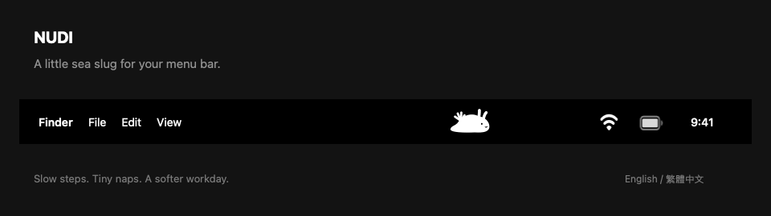

# Nudi · A tiny sea slug for your Mac

**English** | [繁體中文](README.zh-TW.md)

A chubby, monochrome nudibranch that crawls inside its own little space in your macOS menu bar. Click it for a quiet moment together.



*Animated preview rendered with the app’s own character and movement code. The surrounding menu bar is illustrated, not a desktop recording. See the [original character concept](docs/monochrome-chubby-concept.png).*

## Install

Requires **macOS 13 or later**. The universal download contains Apple Silicon and Intel binaries; runtime checks for this release were performed on Apple Silicon.

1. Download `Nudi-0.1.0-macOS-universal.zip` from [Releases](https://github.com/j611062000/nudibranch-pet/releases).
2. Unzip and drag `Nudi.app` to Applications (or your personal `~/Applications` folder).
3. Open Nudi. Look for the little sea slug in the menu bar; there is no Dock icon. The companion panel opens on first launch.

This first release is **ad-hoc signed, not Apple-notarized**. A browser download may be blocked by Gatekeeper. If you trust this build, follow macOS's **System Settings → Privacy & Security → Open Anyway** flow after attempting to open it. Alternatively, build from source below. Do not disable Gatekeeper globally.

## A small companion

- A plump white/black template icon that follows the menu bar's appearance.
- Slow crawling in a reserved region, a pause and turn at each edge, and naps.
- Click anywhere in its region to feed, pet, or put Nudi to sleep.
- **English and Traditional Chinese**, switchable immediately in the panel. The initial language follows the system preference, with English as fallback.
- Local saves for needs, sleep, language, and animation preference. No account, network connection, telemetry, or extra permissions.
- A Reduce Motion toggle, plus respect for the system's Reduce Motion setting.
- No death or punishment for being away. Needs stay within a gentle range.

Use **Quit Nudi** in the panel to exit, or press ⌘Q while the panel is active. Opening the app again shows its panel. To uninstall, quit and move the app to Trash; preferences remain in the `io.github.j611062000.nudi` defaults domain.

Nudi occupies about 108 points of menu bar space. On crowded or notched displays macOS can hide extra items; free up space if it is not visible. It does not overlay other apps' icons, run across the whole bar, or add itself to login items.

## Build from source

Requires Swift 5.9+ with Xcode Command Line Tools or Xcode. No third-party package dependencies.

```sh
./scripts/check.sh                # Core, motion, persistence and language checks
./scripts/build-app.sh            # App and ZIP for the current architecture
./scripts/build-app.sh --universal # Apple Silicon + Intel
```

Regenerate the README animation with `./scripts/render-demo.sh`.

The app and archive are written to `dist/`. `build-app.sh` renders an app icon, validates the bundle, applies an ad-hoc signature, and writes a SHA-256 checksum beside the ZIP. Open `dist/Nudi.app` in Finder to run it.

The checks use a small Swift executable so they also run with Command Line Tools installations that do not include XCTest. A checksum or build passing does not establish notarization or compatibility with every Mac.

## Project layout

- `Sources/PetCore/`: pet state, bounded movement, and bilingual copy.
- `Sources/Nudi/`: AppKit status item, SwiftUI panel, persistence, and vector character.
- `Tests/PetCoreChecks/`: deterministic command-line checks.
- `scripts/`: verification and app packaging.
- `docs/`: [design notes](docs/DESIGN.en.md) and [release verification](docs/VERIFICATION.md).
