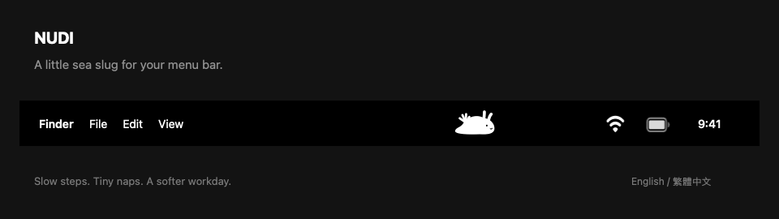

# Nudi

**[下載 Mac 版](https://github.com/j611062000/nudibranch-pet/releases/latest)** · [English](README.md)

一隻住在選單列裡的胖胖海蛞蝓。

*使用 App 繪圖程式產生的動畫示意。*

## 約 1 分鐘開始

1. 下載並解壓縮 Mac ZIP。
2. 把 **Nudi.app** 拖進「**應用程式**」。
3. 開啟，點一下選單列裡的海蛞蝓。

## 陪你慢慢來

- **餵食** → 咀嚼 + 小點心。
- **摸摸** → 開心晃動 + 愛心。
- **睡覺** → 輕輕呼吸 + 小 Z。

繁體中文／英文 · 離線使用 · 自動存檔 · 可減少動畫

**macOS 13+ · 支援 Apple Silicon 與 Intel。** 尚未經 Apple 公證；[開啟說明](docs/GUIDE.zh-TW.md#安裝)。

[使用與開發說明](docs/GUIDE.zh-TW.md) · [驗證紀錄](docs/VERIFICATION.md)
