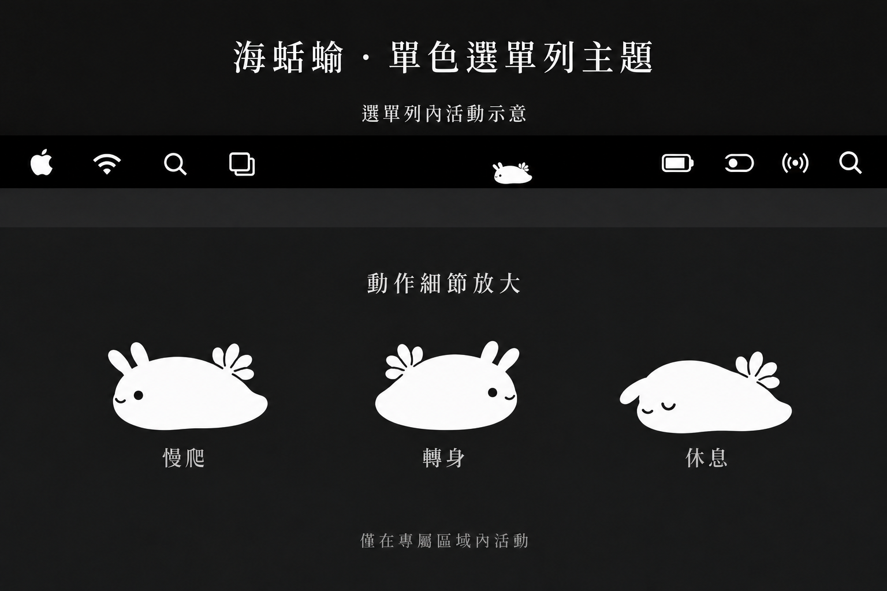

# Nudi · 海蛞蝓選單列寵物

[English](README.md) | **繁體中文**

一隻胖胖的單色海蛞蝓，只在 macOS menu bar 的專屬區域裡慢慢爬行。

**目前是設計與 Swift 原型，還不是可安裝或執行的 App。** 圖片是 AI 輔助製作的概念示意，並非實際執行畫面。



## 已選定的方向

- 單色、圓潤、胖胖的身形，搭配短觸角和小背鰓。
- 身體完整限制在 menu bar 高度內，於 App 自己的固定寬度區域左右活動。
- 緩慢爬行、轉身、停下與休息；不跨越其他 App 圖示。
- 點擊後可展開互動面板，提供餵食、摸摸與睡覺。
- 離線可用、本機儲存；沒有因為忘記照顧而死亡的機制。

## 原型包含什麼

- `Sources/PetCore/`：飽足、心情、精神、睡眠與互動冷卻邏輯。
- `Sources/Nudi/`：SwiftUI 互動面板、繪圖與 UserDefaults 存檔原型。
- `Tests/PetCoreTests/`：時間推進、睡眠、餵食冷卻、數值範圍與存檔測試。
- `docs/`：目前選定的設計稿與實作方向。

**尚未完成：** 原生選單列入口、區域內爬行動畫、單色胖胖角色的程式繪圖、App 打包，以及實機互動驗證。目前 SwiftUI 面板仍是早期的彩色水族箱探索，尚未套用上方最新設計。原型介面目前為繁體中文；英文介面仍待實作。

## 開發與驗證

需要 macOS 13 以上，以及 Swift 5.9 以上。編譯使用 Xcode Command Line Tools 或 Xcode；執行 XCTest 測試需要包含 XCTest 的工具鏈，建議安裝完整 Xcode。沒有第三方套件相依。

```sh
swift build
swift test
```

目前 package 輸出 `NudiPrototype` library，供原型編譯與測試；尚無 `swift run` 入口或可下載的 `.app`。

詳細方向見 [設計說明](docs/DESIGN.md)。

原型 library 已在開發用 Mac 編譯成功。本機僅有 Command Line Tools，`swift test` 因缺少 `XCTest` 模組未能執行，尚不能宣稱測試通過。
